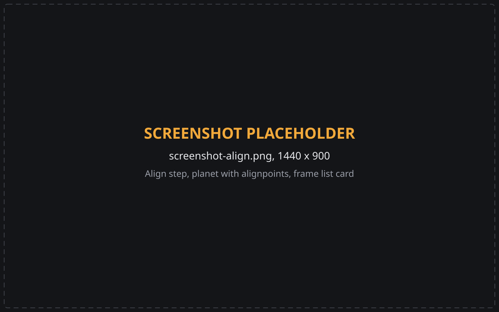

# Siderea Planets

[](https://github.com/PKuhlmay/SidereaPlanets/actions/workflows/ci.yml)

Siderea Planets is a free app for planetary and lunar astrophotography. It aligns the frames of a video, keeps the sharpest ones,
stacks them into one clean image and brings out fine detail with wavelet sharpening. The window leads you through the work step by
step, from opening a recording to saving the finished picture. One app for macOS, Windows and Linux, free software under the
GPL-3.0-or-later. It is still young: the user documentation inside the app says plainly what works and what is not available yet.



*Placeholder image. Real screenshots will replace it.*

## Features

- **Seven steps:** Open, Alignpoints, Align, Best Frames, Stack, Wavelets, Save.
- **Recordings:** SER (8 to 16 bit, mono and colour, Bayer) and AVI (uncompressed, Lagarith, MJPEG, HuffYUV).
- **Alignment and frame rating:** alignpoints on the details of the planet, every frame lined up and rated for sharpness, then
  limited to the best frames.
- **Stacking** of the kept frames, with optional de-rotation for long recordings of fast-turning planets.
- **Wavelet sharpening** with live preview, **Do All**, and wavelet schemes (`.rwv` files) you can store and reuse.
- **Colour and tones:** RGB Align, Color Mixing, RGB Balance, Histogram, Gamma, Contrast/Brightness.
- **Cleaning up:** Denoise/Deringing and Masking, so that sharpening stays on the planet and out of the sky.
- **Finishing:** Flip and Rotate, Crop, Resize Image, Before/After and View Compare, Remember/Restore/Difference.
- **Save image** (TIFF, PNG or FITS, 16 bit) and **project files** (`.sidereaplanets`) to continue a session later.
- **Built-in updater** that finds new versions on GitHub Releases.
- **User documentation inside the app** (Help in the toolbar), also on the [project site](https://pkuhlmay.github.io/SidereaPlanets/).

## Download

Get the latest version from the [Releases page](https://github.com/PKuhlmay/SidereaPlanets/releases/latest) or from the
[project site](https://pkuhlmay.github.io/SidereaPlanets/), which suggests the right file for your system.

| System | File | Notes |
|---|---|---|
| macOS | `.dmg`, one universal app for Apple silicon and Intel | Signed and notarised by Apple |
| Windows | NSIS setup installer (`-setup.exe`) | Not code-signed yet, see below |
| Linux | AppImage and `.deb` | The AppImage updates itself; the `.deb` belongs to your package manager |

**Windows SmartScreen:** because the installer is not code-signed yet, Windows may show "Windows protected your PC". Choose
**More info**, then **Run anyway**.

## Build from source

You need:

- **Rust** through [rustup](https://rustup.rs/). The repository pins the toolchain in `rust-toolchain.toml`; rustup installs it
  (with clippy and rustfmt) the first time you run `cargo` in the checkout.
- **Node.js 24** and **pnpm** (`corepack enable` or `npm install -g pnpm`).
- **cargo-about**, which the build uses to generate the third-party licence notice: `cargo install cargo-about --locked`
  (CI uses version 0.9.3).
- The system libraries of [Tauri 2](https://tauri.app/start/prerequisites/) for your platform:
  - **macOS:** Xcode Command Line Tools (`xcode-select --install`).
  - **Windows:** Microsoft C++ Build Tools (Desktop development with C++) and the WebView2 runtime, which Windows 11 already has.
  - **Linux (Debian and Ubuntu):**
    ```bash
    sudo apt-get install -y --no-install-recommends \
      build-essential file patchelf libssl-dev libxdo-dev \
      libwebkit2gtk-4.1-dev libayatana-appindicator3-dev librsvg2-dev
    ```

Then:

```bash
git clone https://github.com/PKuhlmay/SidereaPlanets.git
cd SidereaPlanets

cd app
pnpm install
pnpm tauri dev          # starts the app with hot reload
```

Do not start the debug binary directly: a debug build expects the Vite dev server, which `pnpm tauri dev` starts for you.

Run the tests:

```bash
cargo test --workspace      # computing core and readers
cd app && pnpm test         # frontend tests
```

Build an installable app:

```bash
cd app
pnpm tauri build            # bundles for the system you build on
```

Signed and notarised release builds for all three systems come from the release workflow
(`.github/workflows/release.yml`), not from a local build.

## Project layout

```
crates/core/     Image type and algorithms: alignment, stacking, wavelets, colour (no GUI code)
crates/io/       Readers and writers for recordings and results (SER, AVI, FITS, export, project file)
crates/session/  Session logic: open recording, results per step, discarding, thread pool, cancel and pause
app/             The app: Tauri 2 shell (src-tauri) and Vue 3 + TypeScript frontend (src)
app/src/docs/    The user documentation as Markdown pages, shown inside the app
site/            The project site, built for GitHub Pages
docs/            Specification, design notes and release process
scripts/         Helper scripts, for example the debug deploy hook
```

## Contributing

Bug reports, ideas and pull requests are welcome. See [CONTRIBUTING.md](CONTRIBUTING.md) for the setup, the checks a change has
to pass and the commit format.

## License

Siderea Planets is free software under the [GNU General Public License, version 3 or later](LICENSE). The third-party licences
of the dependencies are listed in the app (About) and generated at build time.
